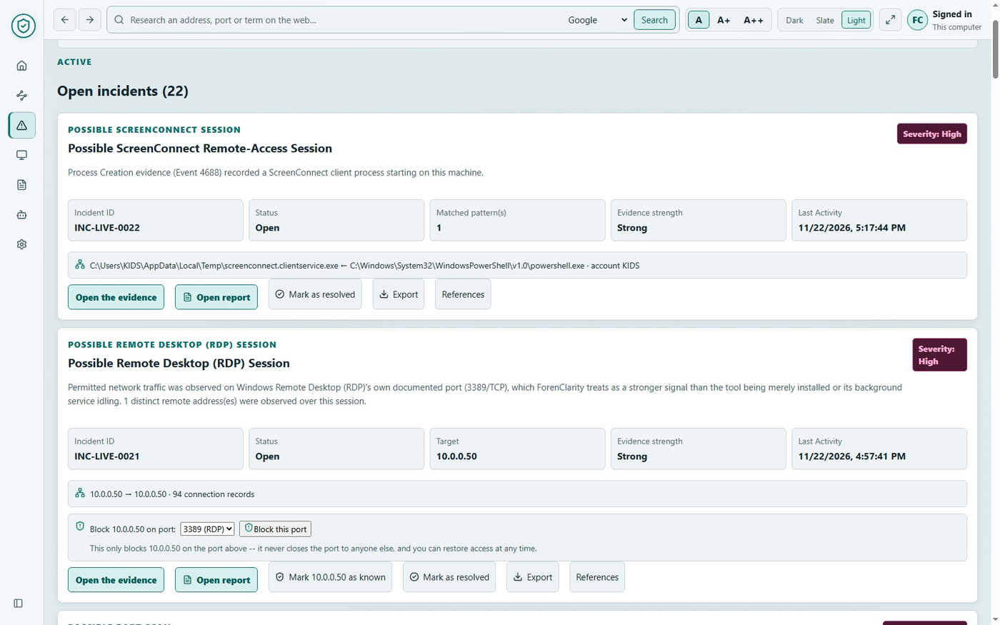

# ForenClarity

**Windows alerts for remote access, tech-support scams, brute-force attempts and port scans, explained with the evidence Windows recorded.**

[**Download for Windows**](https://forenclarity.com/downloads/) · [User guide (PDF)](https://forenclarity.com/documentation/) · [Website](https://forenclarity.com) · [Report a bug](../../issues)



---

## What ForenClarity does

ForenClarity watches a Windows 10 or Windows 11 computer for the warning signs of a tech-support scam, an unauthorized remote-access session, or someone trying to break in. When it finds something, it opens an incident that says what happened in plain language and shows the exact Windows records behind it.

It's built on one rule: **deterministic evidence outranks interpretation.** Every alert links back to records you can check yourself in Event Viewer or the Windows Firewall log.

## What it watches for

| Category | Examples |
|---|---|
| Remote-access tools in use | Remote Desktop (RDP), TeamViewer, AnyDesk, Supremo, RustDesk, VNC, ScreenConnect |
| Password-guessing attempts | Repeated failed logins from the same source in a short time (brute force) |
| Port scans | Many different ports on the computer probed in a short time |

## How it works

- **Reads evidence Windows already keeps:** the Windows Firewall log, the Windows Security log and, optionally, Microsoft Sysmon. No hidden monitoring.
- **Rates the evidence:** each incident shows how strong its evidence is, so a confirmed Windows logon isn't treated the same as a single connection.
- **Alerts you:** incidents appear on the Dashboard, with optional text-message (Twilio) or Telegram alerts so you hear about them even when you're away from the computer.
- **Never blocks on its own:** a connection is only blocked if you click **Block** for one specific address and port, and you can undo it.

## Who it's for

- **Families** protecting a parent or relative from remote-access tech-support scams.
- **Small IT teams** without a dedicated security specialist, who need clear evidence instead of another noisy alert.

## Download and verify

**Free 60-day evaluation.** Download the installer from the [Downloads page](https://forenclarity.com/downloads/).

SHA-256 of `ForenClarity-Setup-20261116_141115.exe`:

```
6679F97BFCDDDB56FB50BBC21A0295C74E86E1AF67091924442A84F75357D976
```

Check it in PowerShell:

```powershell
Get-FileHash "$env:USERPROFILE\Downloads\ForenClarity-Setup-20261116_141115.exe"
```

> **Note:** the installer is not yet code-signed. Windows will likely show a blue "Windows protected your PC" screen. Click **More info**, then **Run anyway**. Verify the SHA-256 fingerprint above first.

## System requirements

- Windows 10 or Windows 11, 64-bit
- About 110 MB of free disk space, plus room for the Windows Firewall log and incident history
- Administrator access during installation only
- Internet only briefly during installation, if you choose the optional Sysmon component (downloaded from Microsoft)

## Documentation

The [81-page user guide](https://forenclarity.com/documentation/) covers installation, every screen and button, what to do when you get an alert, troubleshooting, a FAQ, privacy and data handling, and known limitations.

## Articles

- [How to check if someone is remotely accessing your computer (Windows 10 & 11)](https://forenclarity.com/check-if-someone-is-remotely-accessing-your-computer/)
- [Can you trust AI cybersecurity tools?](https://forenclarity.com/can-you-trust-ai-cybersecurity-tools/)
- [A Windows security alert just fired: what a small IT team should check first](https://forenclarity.com/windows-security-alert-what-to-check/)

## Feedback and bug reports

Found a bug or have a question? [Open an issue](../../issues) and include your Windows version and what you saw. Please don't post personal details, IP addresses or log files that identify you.

## Important note

ForenClarity is not an antivirus and doesn't replace antivirus, EDR, SIEM or professional incident response. It's one extra layer that works from evidence Windows already records, and it can't guarantee to catch every scam or intrusion.

---

This repository contains documentation only. ForenClarity is proprietary software. © 2026 ForenClarity.
